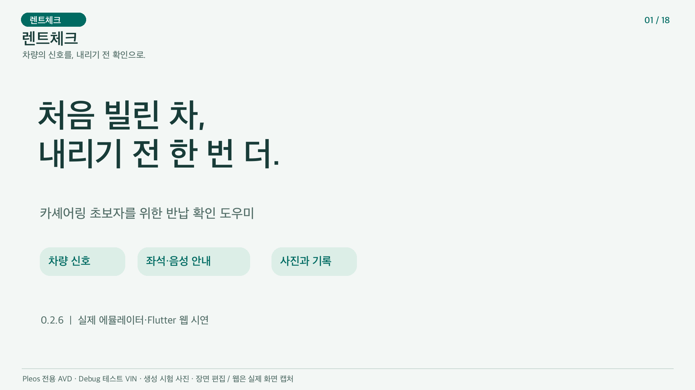

# 렌트체크

처음 카셰어링을 이용하는 사람의 계정 연결·인수·이용·반납 점검을 돕습니다. 차량 신호를 좌석 위치 안내와 한국어 음성으로 연결하고 사진·직접 확인·접수 기록을 보관합니다.

## 차량·Flutter 0.2.8 · 반납 장소 안내

예약별 반납 장소, Pleos FusedLocation의 새 차량 위치 직선거리, P에서 확인하는 NaviHelper 길 안내를 추가했습니다. 실제 목적지·안내 상태를 확인하며 가까워져도 자동 반납하지 않습니다. 위치 권한 거부·오래된 값은 확인 불가로 표시하고 현재 차량 좌표는 서버에 보내지 않습니다. [구현·11조건 실제 SDK 시험·예약 발급·빌드](docs/RETURN_LOCATION_0.2.8.md)

같은 제출 Release에 차량·휴대폰 0.2.8+12 APK와 소스 ZIP·지문을 추가합니다. Android Debug 86/Release 84·Lint 오류 0, 서버 42·Flutter 42(선택 2개 제외)·분석 문제 0 및 두 Release 설치/첫 실행을 확인했습니다. 시험은 분리 Debug AVD의 시험 장소·모의 GPS·테스트 VIN입니다. 사진·최종 접수·TTS 전체 근거와 보존 영상은 0.2.6/0.2.5입니다. 새 영상은 최종 게시 요청 때 갱신합니다.

## 이전 Flutter 0.2.7 · 상단 연결 카드

홈 상단에 차량 연결 카드를 배치해 QR 스캔과 ‘카메라가 없나요? 링크 입력’을 먼저 보여줍니다. 이용할 예약만 홈에 표시하고 완료된 이용은 기록 탭에 보관합니다. 링크 확인 뒤 예약 차량을 선택하고 명시적으로 연결을 승인하는 절차는 그대로입니다.

[기존 제출 Release 페이지](https://github.com/neolabs120-mobile/pleos-rental-check/releases/tag/v0.2.6-submission)에 당시 Flutter 0.2.7 APK·소스를 추가했습니다. 기존 영상은 0.2.6입니다. [변경·검증·빌드 안내](docs/FLUTTER_HOME_0.2.7.md)

## 구성

- app: Kotlin/Compose 차량 앱 0.2.8. Vehicle 2.3.2, vehicle-aidl 1.1.1, TextToSpeech 3.3.1, FusedLocation 1.1.3, NaviHelper 3.0.5.
- mobile: Flutter 이용자 앱과 웹 0.2.8. 계정, 예약, QR 승인, 사진, 직접 확인, 접수.
- server: FastAPI 서버와 사진·계정 처리. requirements-lock.txt 포함.
- scripts, app/src/test, app/src/androidTest, mobile/test, server/test_*.py: 단위·통합 검증.

차량 SDK는 Kotlin 앱에서 호출합니다. Flutter가 차량 SDK를 직접 호출하지 않습니다. 좌석 원시값 1은 비점유, 2는 점유이며 알 수 없는 값은 확인 불가입니다. 사람과 짐은 구분하지 못합니다.

## 시연 영상과 Release APK

[](https://github.com/neolabs120-mobile/pleos-rental-check/releases/download/v0.2.6-submission/rentcheck_demo_0.2.6_3min.mp4)

[0.2.6 제출 자료 릴리스](https://github.com/neolabs120-mobile/pleos-rental-check/releases/tag/v0.2.6-submission)에서 받습니다.

- `rentcheck_vehicle_0.2.8_release.apk`: Kotlin/Compose 차량용, Android 9 이상, 실제 Pleos 환경과 정상 VIN 필요.
- [`rentcheck_mobile_0.2.8_release.apk`](https://github.com/neolabs120-mobile/pleos-rental-check/releases/download/v0.2.6-submission/rentcheck_mobile_0.2.8_release.apk): 최신 Flutter 휴대폰용, Android 7 이상, 상단 연결 카드·링크 입력, 설정에서 HTTPS 서버 주소 입력.
- `rentcheck_demo_0.2.6_3min.mp4`: 1920×1080·30fps·3분, 실제 AVD 화면·Flutter 웹 캡처와 당시 실제 Pleos 출력 음성.
- `SHA256SUMS_0.2.8.txt`: 최신 차량·Flutter APK·소스 ZIP·안내문 지문. 이전 `APK_SHA256.txt`는 0.2.6 APK 두 개의 지문입니다. 새 APK도 같은 배포 키로 서명했고 debuggable=false입니다.
- `rentcheck_source_0.2.8.zip`: 이번 소스 스냅샷입니다. 기존 0.2.6 태그의 자동 Source code ZIP은 이전 버전으로 유지됩니다.

이전 차량 0.2.6·Flutter 0.2.6/0.2.7 APK와 영상·지문 파일도 그대로 보존했습니다. 새 시연 영상은 최종 개선 완료 후 별도 요청에 따라 게시합니다.

시연 영상은 알려진 Pleos ARM64 AVD의 Debug에서 명시적으로 테스트 VIN을 켠 새 체험 예약으로 촬영했습니다. 실제 SDK 창문·좌석과 실제 TTS를 사용하며 생성 시험 사진·장면 편집을 표시했습니다. 로그인된 계정에서 시작하고, 웹 사진 선택·전송·직접 확인·최종 접수는 실제 브라우저로 진행했습니다. 차량 장면은 androidTest의 `SubmissionVideoFlowRunner`가 실제 MainActivity/ViewModel의 동일한 이벤트를 호출하며 예시 UI 상태를 주입하지 않습니다.

이전 [v0.2.6 Debug 체험 APK](https://github.com/neolabs120-mobile/pleos-rental-check/releases/tag/v0.2.6)는 보존했습니다. 에뮬레이터의 정상 SDK VIN 미수신 문제는 남아 있으며 Release에는 테스트 VIN 대체가 없습니다. 두 Release APK의 설치·첫 실행은 확인했지만 정상 VIN을 사용하는 Release 전체 대여 흐름과 실폰 촬영은 미검증입니다. 휴대폰 Release는 HTTP를 허용하지 않으며 공개 운영 서버는 제공하지 않습니다. 서버를 별도로 준비해야 합니다. 기존 Debug와 Release의 서명이 다르므로 기존 Debug 데이터를 지우며 교체하지 말고 별도 시험 환경에서 설치합니다.

[구성·검증·서명 절차](docs/RELEASE_SUBMISSION_0.2.6.md)

## 새 환경 실행

Android Studio, JDK 17 이상, Android SDK 35, Flutter 3.38 이상과 Python을 준비합니다. Gradle·Flutter·Python 의존성은 각 저장소에서 받습니다. 서명 키·SDK·캐시·실제 데이터는 배포하지 않습니다.

차량 앱은 저장소 루트를 Android Studio로 열거나 ./gradlew assembleDebug로 빌드합니다. 기본 Debug 서명 키 또는 본인 키를 사용합니다. 동봉 APK의 기존 개인 서명 키는 포함하지 않았습니다. Android 단위/빌드 검사는 ./gradlew testDebugUnitTest testReleaseUnitTest assembleDebug assembleRelease lintDebug입니다.

아래는 기존 서버와 분리한 로컬 시험 포트 8788 예시입니다. 저장소 루트에서 Python 가상환경을 만들고 server/requirements-lock.txt를 설치합니다.

```sh
python3 -m venv .venv
. .venv/bin/activate
python -m pip install -r server/requirements-lock.txt
export RENTAL_DEVICE_TOKEN="$(python -c 'import secrets; print(secrets.token_urlsafe(32))')"
export RENTAL_MAIL_MODE=file
export PUBLIC_BASE_URL=http://127.0.0.1:8788
```

mobile에서 flutter pub get 후 웹을 만듭니다.

```sh
flutter build web --debug --no-web-resources-cdn --base-href /mobile/ --dart-define=RENTAL_SERVER_URL=http://127.0.0.1:8788
```

서버는 저장소 루트에서 다음과 같이 실행합니다.

```sh
python server/main.py --port 8788 --data-dir server/data --allow-emulator-test-vin --flutter-web-dir mobile/build/web
```

웹은 http://127.0.0.1:8788/mobile/입니다. Android adb reverse tcp:8788 tcp:8788에 해당 Pleos AVD 시리얼을 명시하고 차량 설정에도 같은 서버 주소와 새로 생성한 운영자 키를 입력합니다. 실제 운영자 키와 계정 비밀번호는 저장소에 넣지 않습니다.

파일 메일 모드는 로컬 시험용입니다. 가입 확인번호는 새 server/data/mail-outbox에 생성되며 외부로 메일을 보내지 않습니다. 계정을 만들고 이메일을 확인한 뒤 같은 셸의 운영자 키로 테스트 예약을 발급합니다.

```sh
python server/issue_booking.py --base-url http://127.0.0.1:8788 --email 본인_시험계정 --vin TEST0000000000001 --vehicle-name 체험차량 --demo
```

로그인 → 자동 예약 표시 → 차량 QR 생성·휴대폰 명시 승인 → 인수 저장 → 이용 중 → 반납 시 창문/좌석 새 조회 → 소지품 화면·음성 안내 → 반납 저장 → 사진 3종·직접 확인·메모 → 최종 접수 순서입니다. 카메라가 없으면 차량 QR의 전체 링크를 웹에 입력합니다. 알려진 열린 창문은 직접 확인으로 넘길 수 없습니다. 좌석 안내는 확인 후 닫고 계속 진행할 수 있습니다.

## 검증

최신 0.2.8은 [반납 장소 검증](docs/RETURN_LOCATION_0.2.8.md)을 따릅니다. 아래는 이전 전체 반납·영상 근거입니다.

0.2.6 Android Debug 82/Release 80, 빌드와 Lint 오류 0. 밝은 화면·음성 팝업·연결·620dp/큰 글자·야간 5조건을 확인했습니다. 최신 실제 체험에서 정상 계정 연결·인수·반납 저장 후 Flutter 웹 사진 3장·직접 확인 3종·최종 접수와 차량/웹/서버 번호 일치를 확인했습니다. TTS 10조건은 선행 0.2.5 검증 근거이며 이번 영상에서도 실제 한국어 안내 완료와 출력 PCM을 다시 확인했습니다. 자세한 범위는 docs/VALIDATION.md를 따릅니다.

Release APK 두 개의 설치·첫 실행은 확인했습니다. 실차·정상 VIN 전체 통합·실폰 QR/촬영·iOS는 추가 검증 대상입니다. 앱의 점검 접수는 실제 사업자의 반납·요금 정산과 별도입니다. 자동 손상·책임 판정과 원격 차량 제어는 제공하지 않습니다.

자동 통합 스크립트는 경로 인자를 지정해 사용합니다. macOS 기본 adb 경로는 현재 사용자 홈을 기준으로 하고 Flutter는 PATH에서 찾습니다. 본체 소스는 그대로이며 호스트 시험 스크립트의 도구 기본 경로만 배포 환경에 맞췄습니다.
