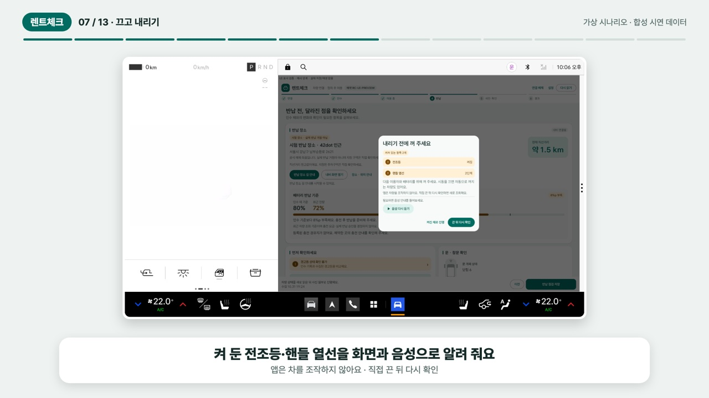

# 렌트체크

카셰어링 차를 처음 빌리면 반납할 때 챙길 게 많습니다. 창문은 닫았는지, 불은 껐는지, 트렁크에 둔 짐은 꺼냈는지 하나씩 떠올려야 하고, 차 상태 사진도 남겨야 합니다. 렌트체크는 이 확인을 차량 화면에서 시작해 휴대폰에서 끝낼 수 있게 만든 앱입니다.

차에서는 창문과 좌석, 켜 둔 조명 같은 상태를 읽어 알려 주고, 탈 때 말로 남긴 짐 메모를 다시 보여 줍니다. 휴대폰에서는 사진을 찍고 직접 확인한 내용을 정리해 점검을 접수합니다.

## 이렇게 씁니다

1. **차량 연결과 인수.** 예약한 이메일로 로그인하고 차량 QR을 확인한 뒤 연결을 승인합니다. 그다음 인수 상태를 저장합니다. 카메라를 쓸 수 없으면 QR에 담긴 링크를 직접 입력해도 됩니다.
2. **짐 메모.** 차를 P에 두고 "트렁크에 캐리어를 뒀어"처럼 말하면 장소와 물건이 정리됩니다. 잘못 알아들었으면 고쳐서 저장하고, 말 대신 직접 입력할 수도 있습니다.
3. **반납 장소로 이동.** 예약된 반납 장소를 확인하고 Pleos 내비로 길 안내를 받습니다. 운영자가 주차장 입구나 층, 구역 안내를 등록해 두었다면 함께 보여 줍니다. 배터리가 인수 때보다 많이 줄었으면 부족한 양과 등록된 충전 경유지를 알려 줍니다. 반납 장소 근처에 도착해 P에 두면 반납 준비를 하자고 제안합니다.
4. **차에서 반납 점검.** 열린 창문부터 확인합니다. 이어서 전조등이나 실내등, 열선처럼 켜 둔 것이 있는지 보고, 짐 메모와 누가 앉아 있던 좌석을 화면과 음성으로 알려 줍니다. 챙긴 물건에 '챙겼어요'를 누르고 점검을 저장합니다.
5. **휴대폰에서 마무리.** 창문과 소지품, 외관 사진을 찍고 직접 확인한 항목을 체크한 뒤 제출합니다. 차에서 다 확인하지 못한 물건은 여기서 이어서 확인할 수 있습니다. 사진 구도 안내와 인수 때 사진과의 비교를 볼 수 있고, 보내기 전 내용은 기기에 임시로 저장됩니다. 서버가 받으면 접수 번호가 나옵니다.

좌석 신호만으로는 사람이 앉았는지 짐이 놓였는지 구분할 수 없습니다. 그래서 신호가 없는 좌석이나 메모하지 않은 곳도 직접 둘러보도록 안내합니다. 문이 열렸던 기록, 이용자가 직접 확인한 곳, 물건 메모는 서로 섞이지 않게 따로 저장합니다.

## APK와 시연 영상

지금 배포 중인 버전은 차량 앱과 휴대폰 앱 모두 **0.4.3+18**입니다. APK와 소스는 [제출 자료 Release](https://github.com/neolabs120-mobile/pleos-rental-check/releases/tag/v0.2.6-submission)에서 받을 수 있습니다.

| 파일 | 설명 |
|---|---|
| [차량용 APK](https://github.com/neolabs120-mobile/pleos-rental-check/releases/download/v0.2.6-submission/rentcheck_vehicle_0.4.3_release.apk) | Kotlin과 Compose로 만든 차량 앱입니다. Android 9 이상, Pleos Connect 환경에서 동작합니다. |
| [휴대폰용 APK](https://github.com/neolabs120-mobile/pleos-rental-check/releases/download/v0.2.6-submission/rentcheck_mobile_0.4.3_release.apk) | Flutter로 만든 휴대폰 앱입니다. Android 7 이상에서 쓰며, 설정에서 연결할 HTTPS 서버 주소를 입력합니다. |
| [소스 코드 ZIP](https://github.com/neolabs120-mobile/pleos-rental-check/releases/download/v0.2.6-submission/rentcheck_source_0.4.3.zip) | 0.4.3 소스입니다. 저장소 main 브랜치와 같습니다. |
| [파일 지문](https://github.com/neolabs120-mobile/pleos-rental-check/releases/download/v0.2.6-submission/SHA256SUMS_0.4.3.txt) | 받은 파일이 원본과 같은지 SHA-256으로 확인할 때 씁니다. |

두 APK 모두 처음 제출할 때 쓴 배포 키로 서명했습니다. 제출한 링크가 바뀌지 않도록 Release 태그는 `v0.2.6-submission`을 계속 씁니다. 다만 GitHub가 자동으로 붙이는 **Source code ZIP은 0.2.6 시점의 소스**라서, 최신 코드는 위의 소스 ZIP이나 main에서 받아 주세요. 이전 APK와 0.2.6 영상도 같은 Release에 그대로 있습니다.

[](https://github.com/neolabs120-mobile/pleos-rental-check/releases/download/v0.2.6-submission/rentcheck_scenario_demo_0.4.3.mp4)

**[대여·반납 시나리오 영상 보기 (0.4.3, 2분 8초)](https://github.com/neolabs120-mobile/pleos-rental-check/releases/download/v0.2.6-submission/rentcheck_scenario_demo_0.4.3.mp4)**

카셰어링을 처음 써 보는 "지수 씨"가 가입하고 예약을 확인한 뒤, 차를 연결해 인수하고, 반납 전에 끄고 내릴 것과 짐을 확인하고, 사진을 올려 접수하기까지를 13장면에 담았습니다.

화면은 실제 앱을 캡처했고, 자막과 합성 음성 내레이션을 입혔습니다. 차량 쪽 기록은 시연용으로 만든 데이터이고 차량 화면은 에뮬레이터에서 찍었기 때문에 실차에서 확인한 결과는 아닙니다. 휴대폰 화면은 [대여·반납 시나리오 시험](docs/FLUTTER_SCENARIO_0.4.3.md) 때 찍은 것입니다.

이전 영상인 [3분 시연 (0.2.6)](https://github.com/neolabs120-mobile/pleos-rental-check/releases/download/v0.2.6-submission/rentcheck_demo_0.2.6_3min.mp4)에는 Pleos 에뮬레이터에서 창문, 좌석, 음성 안내가 동작하는 모습과 Flutter 웹에서 사진을 올려 접수하는 과정이 녹화되어 있습니다.

## Pleos 연동과 프로젝트 구성

Pleos SDK는 차량 앱(Kotlin)에서만 호출합니다. 휴대폰 앱은 서버를 거쳐 예약과 점검 기록을 주고받습니다.

| SDK | 쓰는 곳 |
|---|---|
| Vehicle 2.3.2 | VIN, 기어, 창문, 문, 좌석, 배터리, 주행거리 같은 차량 상태를 읽어 인수와 반납을 비교합니다. 창문 조작 연습과 반납 전 조명, 방향지시등, 와이퍼, 열선 확인에도 씁니다. |
| SpeechToText 3.3.1 | 이용자가 버튼을 눌렀을 때만 한국어 짐 메모를 받습니다. `ON_DEVICE` 모드입니다. |
| TextToSpeech 3.3.1 | 도착 후 반납 준비 제안, 켜 둔 항목, 짐 메모, 앉았던 좌석을 한국어로 읽어 줍니다. `ON_DEVICE` 모드입니다. |
| FusedLocation 1.1.3 | 차의 현재 위치와 반납 장소 사이의 직선거리를 구해 근처에 왔는지 참고합니다. |
| NaviHelper 3.0.5 | 이용자가 승인한 반납 장소로 길 안내를 요청하고, 충전 경유지를 추가하고, 실제로 설정된 목적지와 안내 상태를 확인합니다. |

SDK 2.3.2는 좌석 점유 값을 Boolean으로 바꾸는 과정에서 정보가 빠집니다. 그래서 같은 Vehicle Service의 `vehicle-aidl 1.1.1` 원시값을 함께 읽습니다. API별로 실제로 값을 받았는지와 제약은 [API 활용 현황](docs/PLEOS_API_USAGE_2026-11-01.md)에 정리했습니다.

```text
app/       차량 앱 (Kotlin, Compose)
mobile/    휴대폰 앱과 웹 (Flutter)
server/    FastAPI 서버: 계정, 예약, 사진, 점검 기록
scripts/   에뮬레이터 통합 시험 도구
docs/      기능별 구현과 검증 기록
```

## 직접 실행하기

Android Studio, JDK 17, Android SDK 35, Flutter 3.38 이상, Python이 필요합니다. Pleos SDK, 서명 키, 실제 계정 데이터는 저장소에 넣지 않았습니다.

차량 앱은 저장소 루트를 Android Studio로 열거나 아래 명령으로 빌드합니다. Debug 빌드는 각자의 Debug 키로 서명되고, Release 서명은 [배포 안내](docs/RELEASE_SUBMISSION_0.2.6.md)를 참고하세요.

```sh
./gradlew assembleDebug
```

로컬에서 처음부터 시험 환경을 꾸리는 예시입니다. 먼저 저장소 루트에서 서버 환경과 시험용 키를 준비합니다.

```sh
python3 -m venv .venv
. .venv/bin/activate
python -m pip install -r server/requirements-lock.txt
export RENTAL_DEVICE_TOKEN="$(python -c 'import secrets; print(secrets.token_urlsafe(32))')"
export RENTAL_MAIL_MODE=file
export PUBLIC_BASE_URL=http://127.0.0.1:8788
```

Flutter 웹은 `mobile/`에서 빌드합니다.

```sh
cd mobile
flutter pub get
flutter build web --debug --no-web-resources-cdn --base-href /mobile/ --dart-define=RENTAL_SERVER_URL=http://127.0.0.1:8788
```

다시 저장소 루트로 돌아와 같은 셸에서 서버를 띄웁니다.

```sh
cd ..
python server/main.py --port 8788 --data-dir server/data --allow-emulator-test-vin --flutter-web-dir mobile/build/web
```

웹은 `http://127.0.0.1:8788/mobile/`에서 열립니다. 시험에 쓸 에뮬레이터에만 포트를 연결하고, 차량 앱 설정에도 같은 서버 주소와 시험용 운영자 키를 넣습니다.

```sh
adb -s <Pleos_AVD_시리얼> reverse tcp:8788 tcp:8788
```

메일 모드를 `file`로 두면 확인번호가 `server/data/mail-outbox/`에 파일로 생깁니다. 웹에서 가입하고 이메일 확인까지 마친 뒤, 같은 이메일로 예약을 발급합니다.

```sh
python server/issue_booking.py --base-url http://127.0.0.1:8788 --email 본인_시험계정 --vin TEST0000000000001 --vehicle-name 체험차량 --demo
```

주차장 안내와 충전 경유지 등록은 [반납 마무리 문서](docs/RETURN_COMPLETION_0.4.0.md#운영자-안내-등록)에, 기본 반납 장소를 넣어 예약을 발급하는 방법은 [반납 장소 안내 문서](docs/RETURN_LOCATION_0.2.8.md#시험-예약-발급)에 있습니다. 지금 쓰는 ARM64 에뮬레이터는 정상 VIN을 보내 주지 않아서, SDK 연동 시험을 할 때만 알려진 Pleos AVD의 Debug 빌드에서 테스트 VIN을 명시적으로 켭니다. Release 빌드는 여전히 실제 VIN을 확인합니다.

휴대폰 Release 앱을 쓰려면 HTTPS 서버를 따로 준비해야 합니다. 기본값인 `https://rental.invalid`는 자리만 채운 주소이고, 공개 운영 서버는 제공하지 않습니다. Debug 앱과 Release 앱은 서명이 달라서 덮어 설치할 수 없습니다. 데이터가 남아 있는 Debug 앱을 지우지 말고, 다른 기기나 별도 시험 환경에서 설치해 주세요.

## 검증한 것과 아직 못 한 것

0.4.3 기준으로 Android 테스트는 Debug 108개와 Release 106개, 서버 테스트 51개, Flutter 테스트 56개(선택 실행 2개 제외)가 통과했습니다. Lint 오류와 Flutter 분석 문제는 없습니다.

- **휴대폰 앱 전체 흐름.** 따로 띄운 시험 서버에 붙여 가입부터 최종 접수까지 21단계를 실제 Flutter 화면으로 진행했습니다. 여기서 찾은 표시 문제 세 가지(반납 전 주행거리, 전기차 연료 표시, 시연 데이터 안내)를 0.4.3에서 고쳤습니다. [시나리오 시험 기록](docs/FLUTTER_SCENARIO_0.4.3.md)
- **끄고 내리기 점검.** 빈 Pleos 에뮬레이터에서 Virtual Console로 전조등, 실내등, 방향지시등, 와이퍼, 열선 등 신호 8가지를 켜고 실제 SDK로 읽었더니 12개 항목이 켜짐으로 잡혔고, 다시 끄자 0개로 돌아왔습니다. 앱은 상태를 읽기만 하고 차량을 조작하지 않습니다. 안개등은 이 에뮬레이터가 값을 주지 않아 '지원 안 함'으로 처리합니다. [끄고 내리기 기록](docs/SWITCH_OFF_0.4.2.md)
- **반납 마무리.** 읽기 전용 Pleos 에뮬레이터에서 반납 통합 조건 11개를 확인했고, 웹에서 PNG, JPEG, WebP 사진 선택, 새로고침 후 복구, 직접 확인, 최종 접수까지 해 봤습니다. 시험 차량 배터리는 인수 80%에서 반납 72%로, 기준보다 8%p 부족하다고 안내했습니다. [반납 마무리 기록](docs/RETURN_COMPLETION_0.4.0.md)
- **음성 메모와 도착 제안.** 0.3.0에서 실제 SDK로 13개 조건을 확인한 결과를 그대로 이어 씁니다. [0.3.0 기록](docs/VOICE_ARRIVAL_0.3.0.md)

아직 확인하지 못한 것도 있습니다. 실차에서 돌려 보지 않았고, 정상 VIN을 받는 Release 전체 흐름, Galaxy Fold8 실물 카메라 촬영, 실제 단말의 통신 끊김 상황도 검증하지 못했습니다. 충전 경유지는 내비 경로에 실제로 전달되지만, 에뮬레이터가 경유지 좌표를 0,0으로 돌려줘서 앱에서는 확인 완료로 표시하지 않고 내비 화면에서 직접 보라고 안내합니다.

몇 가지는 일부러 하지 않습니다. 반납 장소 근처에 있거나 P에 있다는 것만으로 지정 구역에 세웠다거나 반납이 끝났다고 판단하지 않습니다. 음성 원본과 차의 현재 좌표는 서버에 남기지 않고, 이용자가 확인하고 저장한 짐 메모만 반납 기록에 들어갑니다. 앱에서 점검을 접수해도 실제 업체의 반납 처리나 요금 정산과는 별개입니다.

그 밖의 기록: [화면 개선 0.4.1](docs/UI_POLISH_0.4.1.md) · [전체 검증 이력](docs/VALIDATION.md) · [차량 UI 0.2.9](docs/NATIVE_UI_0.2.9.md) · [반납 장소 0.2.8](docs/RETURN_LOCATION_0.2.8.md)
