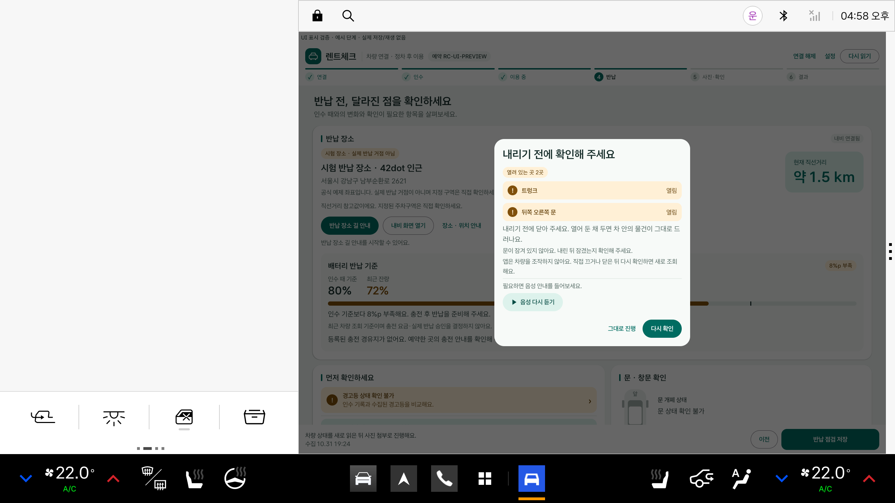
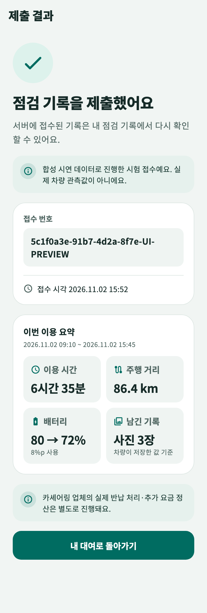

# 0.4.4 문·트렁크 닫힘 확인과 이용 요약

차량·휴대폰 앱 0.4.4+19의 변경과 검증 기록입니다.

## 차량: 내리기 전 문·트렁크 확인

반납 점검을 시작하거나 저장할 때, 켜 둔 장치와 함께 문·트렁크·보닛이 열려 있는지도 Pleos Vehicle SDK로 새로 읽습니다.

- 열려 있는 곳이 있으면 창문 확인 다음에 화면과 Pleos 음성으로 알려 줍니다. 닫은 뒤 다시 확인하거나, 그대로 진행할 수 있습니다.
- 문 잠금 해제는 내린 뒤에 잠그는 것이므로 창을 띄우지 않고 “내린 뒤 잠겼는지 확인해 주세요”라고만 안내합니다.
- 읽지 못한 문은 닫힘으로 세지 않고 ‘확인하지 못한 항목’으로 남깁니다.
- 앱은 차량을 조작하지 않습니다. 새 권한도 없습니다.

위 화면은 표시 검증용 예시 데이터로 그린 것입니다.

### 실제 SDK 확인

빈 데이터 Pleos 에뮬레이터에서 Virtual Console로 문 상태를 바꾸고, 앱의 실제 데이터 소스로 읽었습니다.

| 단계 | 열림으로 읽힌 곳 | 닫힘으로 읽힌 곳 |
|---|---|---|
| 모두 닫음 | 0 | 6 |
| 뒤 오른쪽 문과 트렁크 열기 | 2 (뒤 오른쪽 문, 트렁크) | 4 |
| 다시 닫음 | 0 | 6 |

이 에뮬레이터는 승객 문 네 개의 잠금을 한 묶음으로 보고합니다. 잠금 해제 상태는 Console에서 바꾸지 못해 실제 SDK로는 ‘잠김’만 읽었고, 해제 안내는 단위 테스트와 화면 예시로 확인했습니다.

## 휴대폰: 이번 이용 요약

점검을 제출하면 접수 완료 화면에 이용 시간, 주행 거리, 배터리(연료 차량은 연료) 변화, 올린 사진 수를 한 장으로 보여 줍니다.

- 서버가 이미 저장한 인수·반납 값만 씁니다. 추정하거나 다시 재지 않습니다.
- 제출 직후 기존 기록 조회로 한 번 받아 오고, 실패하면 요약 없이 이전처럼 표시합니다. 서버는 바꾸지 않았습니다.

위 화면은 예시 값으로 렌더링한 것입니다. 실제 서버에 연결한 제출 흐름에서는 확인하지 않았습니다.

## 검증

- Android 단위 테스트 Debug 112개, Release 110개, Lint 오류 0
- Flutter 테스트 60개(선택 실행 2개 제외), 분석 문제 0
- 서버는 변경이 없어 51개 그대로입니다.
- 실차, 실제 휴대폰에서는 확인하지 않았습니다.
