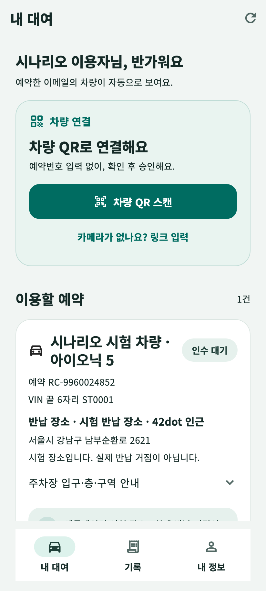
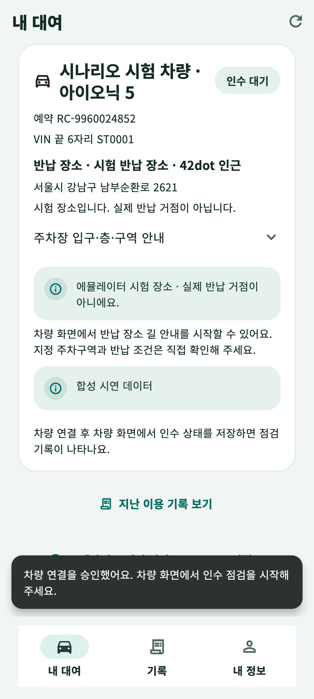
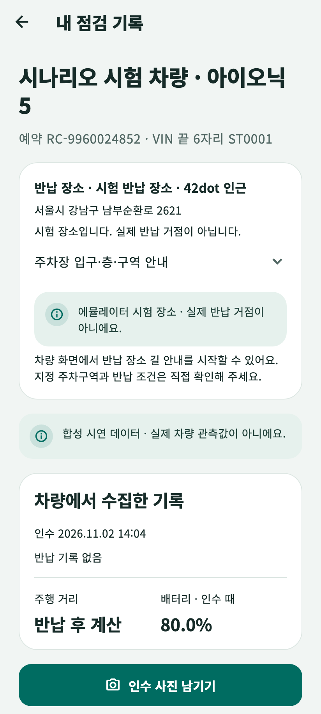
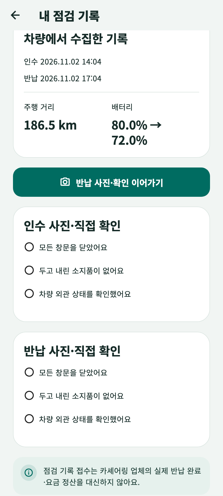
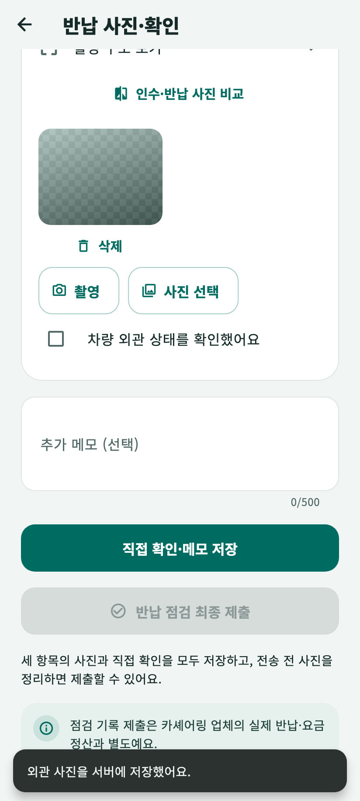
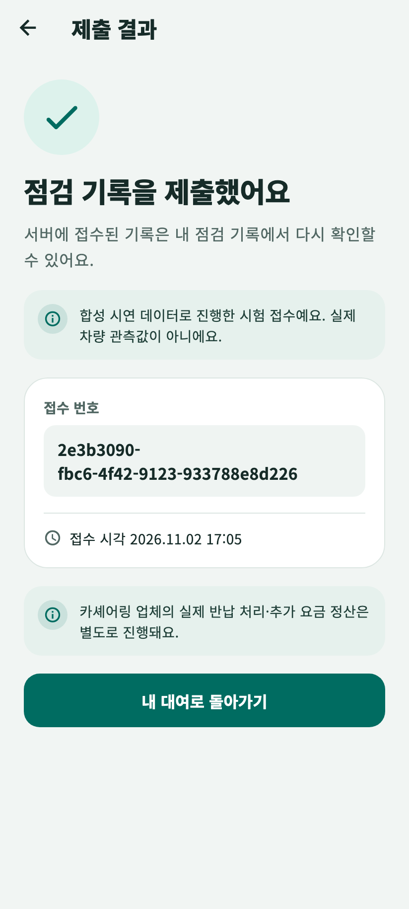

# 대여·반납 시나리오 시험 · 0.4.3

휴대폰 앱으로 차를 빌리고 반납하는 과정을 처음부터 끝까지 실제 Flutter 화면으로 진행했습니다. 시험 코드가 버튼을 누르고 입력하며, 단계마다 화면을 캡처했습니다.

## 시험 환경

- 서버: 운영 데이터와 분리한 로컬 시험 서버(별도 포트·데이터 폴더, 파일 메일 모드).
- 휴대폰 앱: 실제 화면과 실제 HTTP 통신. 휴대폰 크기(412×915)에 한글 글꼴을 적용해 렌더링했습니다.
- 차량 쪽: QR 발급과 인수·반납 기록은 서버의 차량용 API로 **합성 시연 데이터**를 보냈습니다. 앱에도 합성 데이터로 표시됩니다.
- 사진: 시험용으로 만든 이미지 3장을 사진 선택기 결과로 넘겼습니다.

실차·실기기 카메라·QR 스캔 시험이 아닙니다.

## 진행 단계 (21단계 통과)

1. 시작 화면 → 가입 정보 입력 → 이메일 확인번호 → 로그인
2. 운영자가 발급한 예약이 예약번호 입력 없이 자동 표시
3. 차량 QR 링크 입력 → 연결 승인 확인창 → 승인 완료(차량 쪽 상태 “연결됨”)
4. 차량이 인수를 저장하자 홈이 “점검 진행 중”으로 바뀌고 인수 기록이 표시
5. 차량이 반납을 저장(짐 메모 2개, 배터리 80%→72%)
6. 사진·직접 확인 전에는 최종 제출 버튼 비활성
7. 창문·소지품·외관 사진 미리보기와 전송 → 물건별·직접 확인과 메모 저장
8. 최종 제출 확인창 → 서버 접수 번호 → 기록 탭에 “제출 완료”

| | | |
|---|---|---|
|  |  |  |
|  |  |  |

## 시험에서 찾아 고친 것

- 반납 전 주행 거리가 “미수신”으로 보였습니다 → “반납 후 계산”으로 표시합니다.
- 전기차인데 “연료 잔량 미수신 → 미수신”이 보였습니다 → 연료 값이 없고 배터리 기준이 있으면 “배터리 · 인수 때 80.0%”, 반납 후 “80.0% → 72.0%”를 보여 줍니다.
- 안내 문구의 “렌터카 업체”를 “카셰어링 업체”로 바꾸고, 합성 시연 데이터 접수는 제출 결과 화면에도 표시합니다. 동의 버전에 묶인 이용약관 문구는 버전 변경 없이 바꾸지 않았습니다.

새 위젯 테스트 3개(`mobile/test/record_energy_test.dart`)가 위 표시를 확인합니다.
