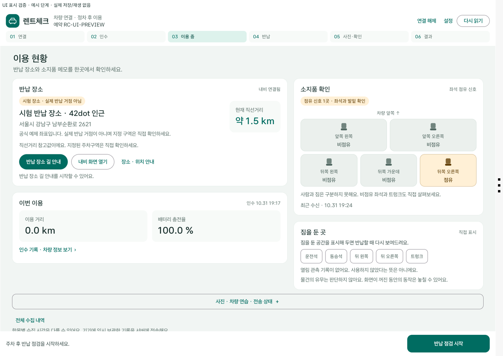

# 차량 UI 0.2.9 · 글자와 정보 배치 정리 · 2026-11-02

화면마다 글자 크기가 달랐고 설명·상태·수치가 한꺼번에 보여 중요한 정보를 찾기 어려웠습니다. 밝은 바탕과 짙은 청록을 유지하면서 Pleos 오른쪽 렌트체크 앱 영역의 글자와 정보 배치를 정리했습니다. Flutter·서버·SDK 판정은 0.2.8을 유지합니다.

## 바뀐 화면

- 같은 Sans Serif 글꼴과 기준선을 사용합니다. 제목 32/26/22sp, 본문 20sp, 보조문구 18sp, 버튼 18sp를 기준으로 맞췄습니다. 작은 상태·시각 표시는 16sp이며 길 안내·반납 등 주요 버튼은 최소 52dp입니다.
- 이용 중 화면의 왼쪽에는 반납 장소·직선거리·길 안내와 이용 요약을, 오른쪽에는 좌석 배치도·짐 메모를 둡니다. 반복된 인수/현재 잔량 카드를 요약으로 합쳤고 원래 수집값·인수 값·창문 직접 확인 여부는 세부 정보에서 봅니다.
- 장소명과 거리를 구분하고 긴 설명은 두 줄과 ‘장소·위치 안내’로 제공합니다. 전체 운영자 안내·위치 사용 설명은 대화상자에서 읽을 수 있습니다. 실제 내비 오류·취소·시간 초과는 계속 표시합니다.
- 사진·90초 창문 연습·서버 전송은 ‘사진·차량 연습·전송 상태’ 보조 영역에서 엽니다. 반납 점검 버튼은 화면 아래에 고정합니다.
- 큰 글자·좁은 화면에서는 카드를 쌓고 현재 단계를 표시합니다. 야간 색상과 시험 VIN 안내도 같은 색상 체계를 사용합니다.
- 좌석은 점유/비점유/확인 불가를 색과 글자로 구분합니다. 사람·짐을 구분하거나 비점유를 소지품 없음으로 판단하지 않습니다. 짐 메모는 저장 식별자를 유지하고 화면의 위치 이름만 줄였습니다.



위 그림은 **예시 단계의 Compose 화면 배치 검토**입니다. 실제 새 SDK 수신·음성·저장·길 안내 성공을 뜻하지 않습니다. 기존 완료 기록을 표시 자료로 사용하며 상단에 검토용임을 표시했습니다.

## 검증과 보존

| 항목 | 확인한 범위 |
|---|---|
| Android 단위 검사 | Debug 86 / Release 84 전부 통과 |
| 빌드·Lint | Debug·Release·시험 APK 성공, 오류 0 / 기존 경고 24 |
| 실제 네이티브 표시 검토 | 별도 데이터의 Pleos AVD에서 이용 중·소지품 음성 팝업·반납·인수·연결·620dp/글자1.3배·야간·위치 미수신·긴 장소명·결과의 10조건 |
| 현재 예약 | 기존 체험 예약 RC-F48FB9527E의 ACTIVE·인수 revision1을 보존하고 정상 MainActivity의 새 UI·실제 직선거리·길 안내 버튼을 확인. 반납 이벤트 없음 |
| 설정·DB | 같은 Debug 키 업데이트 전후 설정 39개 바이트 동일. 서버 11개 테이블의 기존 모든 행 동일 |
| Release | 기존 배포 키·0.2.9+13·debuggable=false·16KB 정렬·테스트 VIN/검토 러너 제외·별도 AVD 설치/첫 실행·크래시 없음 |
| 변경하지 않은 기능 | 예약/QR 승인·P/VIN 재조회·창문 차단·좌석 판정·TTS·사진/직접 확인·최종 접수 조건, 서버·Flutter |

UI 예시 검토와 실제 SDK 통합 근거를 구분합니다. 위치·내비·반납 저장 11조건과 서버/Flutter 42개(선택 통합 2개 제외)는 [선행 0.2.8 결과](RETURN_LOCATION_0.2.8.md)입니다. 사진·최종 접수·TTS 전체 근거와 기존 영상은 0.2.6/0.2.5 기록입니다. 이번에는 이 전체 흐름을 다시 실행하거나 새 영상을 올리지 않았습니다. 실차·정상 VIN Release 전체 통합·실폰 QR/촬영·iOS는 여전히 미검증입니다.

## 배포와 실행

같은 [제출 Release](https://github.com/neolabs120-mobile/pleos-rental-check/releases/tag/v0.2.6-submission)에 다음 파일을 추가합니다. 이전 APK·영상·자료는 그대로 보존합니다.

- 새 차량: `rentcheck_vehicle_0.2.9_release.apk`, **0.2.9+13**, **43,320,661바이트**.
- SHA-256: `7debac89a07ad250262e623af238edcbb47165be41575a976430c48785f06fc4`.
- 기존 Release 인증서: `35d839af51ea4d192240a18140bd4c0b911fa04682fe644ad5802896b9825fc8`.
- 휴대폰 APK는 **rentcheck_mobile_0.2.8_release.apk**를 유지합니다. Flutter를 다시 빌드하지 않았습니다.
- 최신 소스는 `rentcheck_source_0.2.9.zip` 또는 main, 지문은 `SHA256SUMS_0.2.9.txt`, 안내는 `RELEASE_README_0.2.9.md`입니다. 이전 태그의 자동 Source code ZIP은 0.2.6 스냅샷입니다.
- 기존 영상은 **0.2.6**입니다. 새 영상은 최종 게시 요청 때만 갱신합니다.

```sh
./gradlew testDebugUnitTest testReleaseUnitTest assembleDebug assembleRelease lintDebug
```

[기존 서명 절차](RELEASE_SUBMISSION_0.2.6.md#다시-빌드하기)를 따라 동일 배포 키로 서명합니다. Release의 실제 VIN·HTTPS 검증을 완화하지 않았고 휴대폰 Release에는 별도 HTTPS 서버가 필요합니다. 기존 Debug 데이터를 지우며 다른 키의 Release로 교체하지 않습니다. 반납 장소 발급·에뮬레이터 테스트 VIN·SDK 권한 절차는 0.2.8 안내를 따릅니다.
