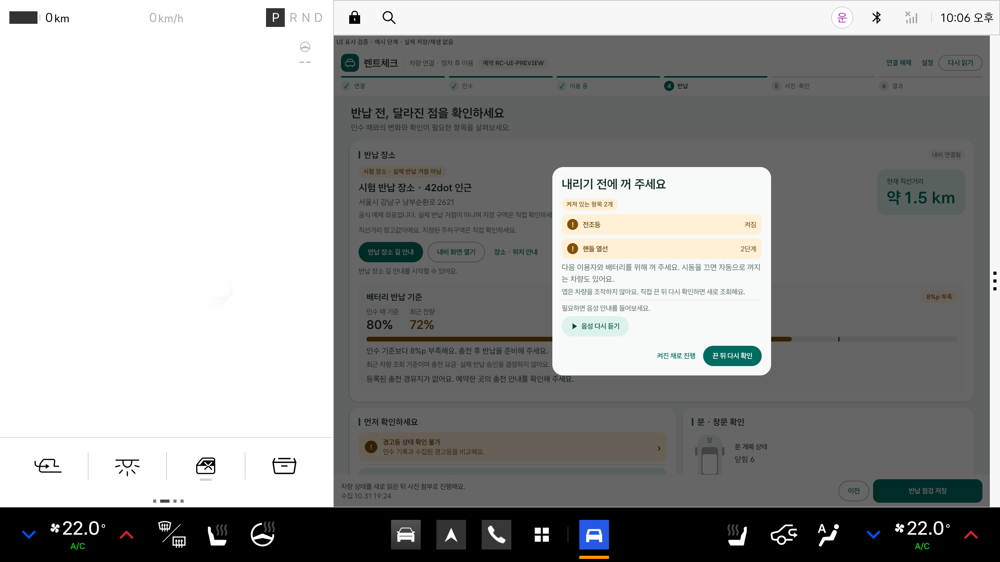

# 끄고 내리기 점검 · 0.4.2

차량 0.4.2+17은 반납 직전에 켜 두기 쉬운 것들을 Pleos Vehicle SDK로 다시 읽어 알려 줍니다. 앱은 읽기만 하며 차량을 조작하지 않습니다.

## 확인하는 항목

| 영역 | 항목 | 켜짐으로 보는 값 |
|---|---|---|
| Light | 전조등·상향등·미등·앞/뒤 안개등·실내등·좌석별 독서등 | `LightState.ON` (주간주행등은 제외) |
| TurnSignal | 방향지시등 | `LEFT`, `RIGHT` |
| Wiper | 앞·뒤 와이퍼 | 작동 중(`WiperState.ON`) 또는 수동 속도 위치(간헐·연속·미스트) |
| HVAC | 앞·뒤 유리 열선 | `true` |
| SteeringWheel | 핸들 열선 | 1단계 이상 |
| SideMirror | 사이드미러 열선 | 1단계 이상 |

각 항목은 지원 여부(`checkXxxCapabilities`)를 먼저 확인하고 4초 안에 응답한 값만 씁니다. 실패·시간 초과·권한 거부는 ‘확인하지 못한 항목’으로 남기고, 차량에 없는 기능은 안내하지 않습니다. 공조 전원과 에어컨은 주행 중 켜져 있는 것이 정상이고 시동과 함께 꺼지므로 알림에서 제외했습니다. SDK 2.3.2에는 주차 브레이크 상태와 비상등을 따로 읽는 API가 없습니다.

새 읽기 권한: `pleos.car.permission.CAR_LIGHTS`, `CAR_CLIMATE`, `CAR_MIRRORS` (와이퍼는 기존 `CAR_WINDOWS`). 제어 권한은 선언하지 않았습니다.

## 반납 흐름

1. 반납 시작·다시 읽기·저장 때 창문을 먼저 확인합니다. 열린 창문은 지금처럼 저장을 막습니다.
2. 창문이 정상이면 켜져 있는 항목을 이름과 상태로 보여 주고 Pleos TextToSpeech로 읽습니다.
3. ‘끈 뒤 다시 확인’은 새로 조회합니다. ‘켜진 채로 진행’은 이 목록을 확인한 것으로 기록하고 저장을 이어갑니다. 다른 항목이 새로 켜지면 다시 알려 줍니다.
4. 그다음 짐 메모·점유 좌석 안내가 이어집니다. 조회 값은 반납 기록에 함께 저장돼 서버로 전송되고 인수·반납 비교에도 나타납니다.

시동을 끄면 자동으로 꺼지는 차량도 있어 저장을 막지 않습니다. 센서 값이 틀렸을 때 이용자가 반납하지 못하는 일을 피하기 위해서입니다.

## 검증

- Android Debug 108개·Release 106개 통과(새 모델·음성 검사 8개), Lint 오류 0.
- 빈 데이터 Pleos 2.1.0 ARM64 AVD에서 `SwitchOffProbeRunner`가 실제 `PleosVehicleDataSource`로 읽었습니다. Virtual Console로 모두 끈 상태 → 켜짐 0개·꺼짐 17개, 하향등·상향등·실내등·앞 왼쪽 독서등·왼쪽 방향지시등·앞 와이퍼·앞 유리 열선·핸들 열선 2단계를 켠 상태 → 켜짐 12개, 다시 끈 상태 → 0개.
- 이 AVD는 안개등의 지원 확인을 통과하지만 실제 조회에서 `ERROR_NOT_SUPPORTED_PROPERTY`를 반환해 ‘지원 안 함’으로 처리합니다. 독서등은 앞 왼쪽만 켜도 네 좌석이 모두 켜짐으로 수신돼 좌석별 구분은 이 AVD에서 확인하지 못했습니다. 사이드미러 열선은 Console에서 바꿀 수 없어 꺼짐 상태만 확인했습니다.
- 안내 창은 `NativeVisualReviewRunner`의 표시용 예시 단계로 검토했습니다. 연결된 예약으로 실제 반납 화면에서 안내 창이 뜨는 전체 흐름은 이번에 반복하지 않았고, 실차 시험도 하지 않았습니다.
