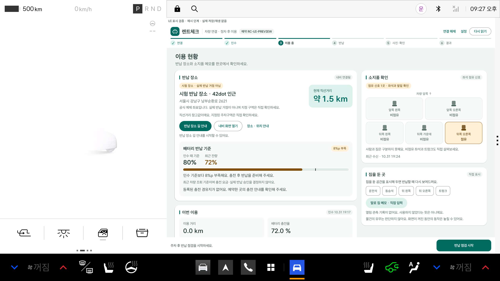

# 화면 다듬기 · 0.4.1

차량·Flutter 0.4.1+16은 0.4.0의 기능·판정·저장 조건을 그대로 두고 화면의 위계와 일관성을 다듬었습니다.

## 차량 앱 (Kotlin · Compose)

- 6단계 진행 표시: 완료 단계는 ✓, 현재 단계는 채운 원과 굵은 글씨, 남은 단계는 옅게 표시하고 위에 진행 막대를 둡니다.
- 카드: 모서리를 넓히고 옅은 그림자와 제목 강조선을 넣었습니다. 시각·연결 상태 같은 보조 정보는 작은 배지로 표시합니다.
- 배터리 반납 기준: 인수 기준과 최근 잔량을 큰 숫자로 나란히 보여 주고, 부족하면 ‘%p 부족’ 배지와 기준 눈금이 있는 막대를 표시합니다. 판정·문구 조건은 0.4.0과 같습니다.
- 상태 행은 주의 `!`, 확인 `✓` 원형 아이콘을 함께 표시해 색에만 의존하지 않습니다. 비교 행의 값은 오른쪽에 정렬합니다.
- 반납 장소 직선거리를 강조하고, 소지품 확인 팝업의 체크박스와 물건 이름을 한 줄에 둡니다. 점유 좌석 테두리를 강조합니다.

## 휴대폰 앱 (Flutter)

- 차량 앱과 같은 청록 팔레트·글자 굵기·버튼 높이(54)·입력칸·대화상자 모양을 `mobile/lib/ui/app_theme.dart`로 통일했습니다.
- 시작 화면 카드는 글자 크기가 커지면 함께 늘어납니다.
- 배터리 안내는 차량과 같은 숫자·배지·막대 형태로 보여 줍니다. 제출 결과는 접수 번호를 강조합니다.

## 검증

- Android Debug 100개·Release 98개 통과, Lint 오류 0.
- Flutter 분석 문제 0, 테스트 53개 통과(선택 실서버 통합 2개 제외). 좁은 화면·글자 1.5배 시작 화면 검사 포함.
- 화면 검토: 빈 데이터의 Pleos AVD에서 `NativeVisualReviewRunner`의 표시용 예시 단계 10개, Flutter 위젯 테스트 렌더(모의 데이터). 실제 SDK 수신·저장·접수 결과가 아니며 실제 SDK·서버 흐름은 [0.4.0 검증](RETURN_COMPLETION_0.4.0.md)을 이어갑니다.
- 두 Release APK는 기존 배포 키·debuggable=false·16KB 정렬과 설치·첫 실행을 확인합니다.

실차·정상 VIN Release 전체 이용·실폰 QR/촬영은 여전히 추가 확인이 필요합니다. 시연 영상은 0.2.6 기준입니다.
